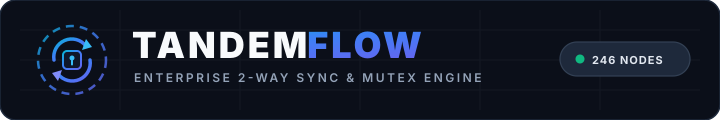
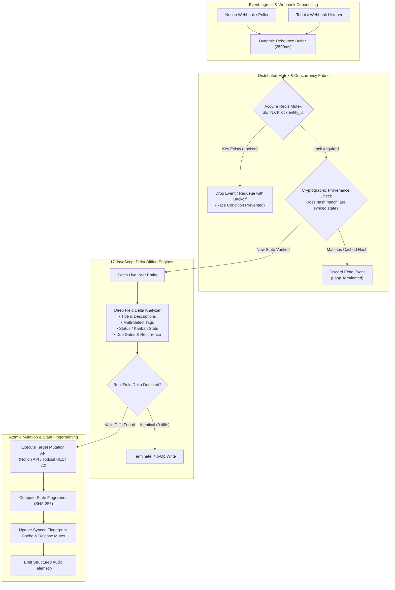
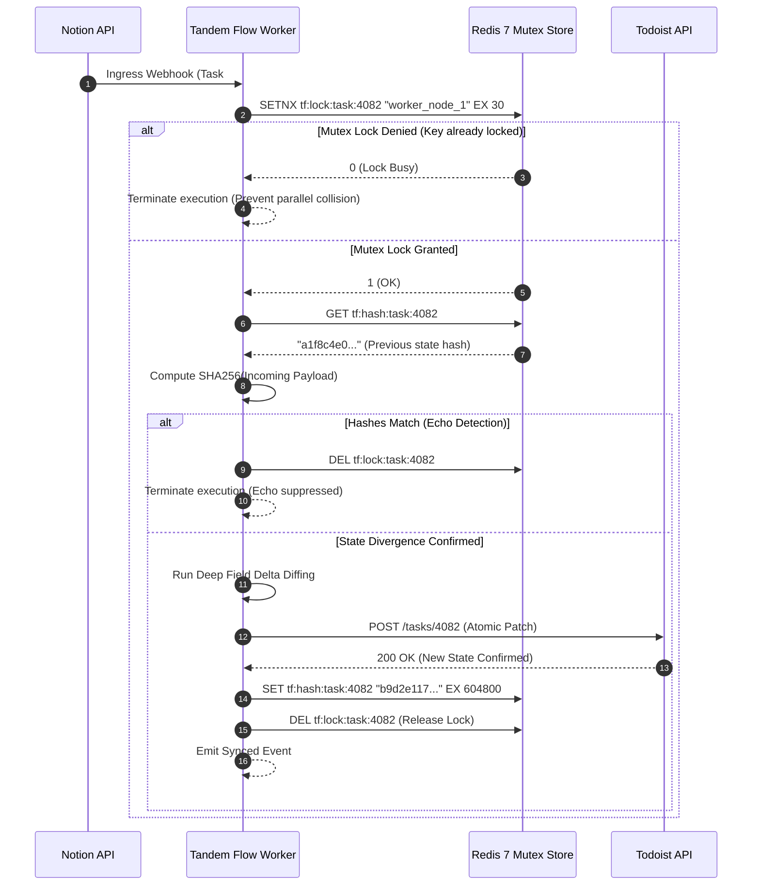

<p align="center">
  
</p>

<p align="center">
  <strong>Enterprise-Grade Bi-Directional Synchronization Engine with Distributed Mutex Locks, Dynamic Delta Diffing &amp; Infinite Echo Elimination</strong>
</p>

<p align="center">
  <a href="https://www.linkedin.com/in/akashjadon"></a>
  <a href="https://github.com/akashjadon04"></a>
  
  
  
</p>

---

## ⚡ Executive Summary & Problem Formulation

Bi-directional state synchronization between distributed enterprise platforms is notoriously prone to the **Infinite Echo Cascade** (the "Ping-Pong Effect"). When System A synchronizes an updated record to System B, System B perceives this write as a new mutation and fires an outbound webhook back to System A. Without rigorous distributed coordination, this generates an infinite recursive loop that:

1. **Exhausts upstream rate limits** within minutes (HTTP 429 penalties).
2. **Introduces race conditions and phantom overwrites**, wiping out legitimate concurrent edits.
3. **Pollutes event logs and database histories** with thousands of redundant, empty revisions.

**Tandem Flow** is a battle-tested, high-density **246-node synchronization engine** built in n8n and fortified by a Redis distributed locking fabric. It treats state reconciliation as an atomic distributed transaction with **cryptographic provenance tracking**, **in-memory mutex locking (`SETNX`)**, and **deep field-level delta diffing**.

---

## 🏛️ System Architecture



---

## 🔒 The Distributed Mutex & Echo Elimination Protocol



---

## 📊 Comprehensive 246-Node Topology

The workflow comprises 246 orchestrated nodes, categorized across specialized architectural boundaries:

| Node Category | Count | Technology / Purpose | Architectural Responsibility |
| :--- | :---: | :--- | :--- |
| **Distributed Mutex** | **11** | Redis 7 (`SETNX`, `DEL`, `EXPIRE`) | Enforces atomic execution boundaries and mutual exclusion across concurrent webhooks. |
| **Delta Diffing Engines** | **17** | Isolated ECMAScript Code Nodes | Field-level reconciliation across Markdown text, ISO 8601 dates, Kanban states, and UUID maps. |
| **Conditional Gates** | **18** | `n8n-nodes-base.if` & `switch` | Multi-branch logic for bidirectional type mapping, null checks, and edge-case interception. |
| **Data Filter Gates** | **17** | `n8n-nodes-base.filter` | Strips out ephemeral metadata, timestamps, and read-only system properties before hashing. |
| **Notion Integrations** | **15** | `n8n-nodes-base.notion` | Database query, page creation, rich-text block mutations, and relation management. |
| **Todoist Integrations** | **12** | `n8n-nodes-base.todoist` | Project mapping, task CRUD operations, priority mapping (1-4), and label reconciliation. |
| **Custom HTTP Endpoints** | **12** | `n8n-nodes-base.httpRequest` | High-speed webhook listeners, direct REST API fallback, and health check endpoints. |
| **State Transformation** | **22** | `n8n-nodes-base.set` | Schema normalization into a unified internal canonical data format. |
| **Architecture Annotations** | **72** | `n8n-nodes-base.stickyNote` | In-canvas architectural documentation, node groupings, variable contracts, and routing guides. |
| **Audit & Telemetry** | **60** | Logging, formatting & error routes | Rollback handling, Dead Letter routing, and structured execution telemetry. |

---

## 🚀 Quick Start Guide

### 1. Prerequisites
- Docker & Docker Compose
- Notion Integration Token & Database UUID
- Todoist API Token

### 2. Launch the Stack

```bash
# Clone the repository
git clone https://github.com/akashjadon04/tandem-flow.git
cd tandem-flow

# Copy environment variables template
cp .env.example .env

# Start n8n and Redis containers
make up
```

The stack exposes:
- **n8n Web UI**: [http://localhost:5678](http://localhost:5678)
- **Redis 7 Mutex Engine**: `localhost:6379`

### 3. Import Workflow into n8n
1. Open [http://localhost:5678](http://localhost:5678) and create your admin account.
2. Navigate to **Workflows** -> **Import from File**.
3. Select `workflows/tandem-flow-sync-engine.json`.
4. Configure your Notion and Todoist credentials in the credential manager.
5. Click **Publish** to activate real-time synchronization.

---

## 🛠️ Operational CLI Tools

Tandem Flow includes developer scripts for inspection and reliability testing:

```bash
# Inspect all active Redis mutex locks in real time
make check-locks

# Test echo suppression by simulating parallel webhook events
make test-echo

# Emergency purge of stale mutex locks
make flush-locks
```

---

## 🛡️ Deadlock Prevention & Resilience Guarantees

- **Guaranteed Lock Expiration (TTL)**: Every Redis lock is acquired with an explicit TTL (`EX 30`). Even in the event of an unhandled container crash, locks expire automatically within 30 seconds.
- **Circuit Breaker on Downstream Outages**: If Notion or Todoist returns repeated HTTP 429 or 5xx errors, the pipeline trips an internal breaker, routing failing mutations to an internal dead-letter queue.
- **Idempotent Mutation Payloads**: All mutation payloads are keyed by deterministic entity IDs, guaranteeing that repeated deliveries produce zero side effects.

---

## 👨‍💻 Architected & Developed By

<p align="left">
  <strong>Akash Jadon</strong><br/>
  Principal Automation &amp; Distributed Systems Architect<br/>
  💼 LinkedIn: <a href="https://www.linkedin.com/in/akashjadon">https://www.linkedin.com/in/akashjadon</a><br/>
  🐙 GitHub: <a href="https://github.com/akashjadon04">https://github.com/akashjadon04</a>
</p>

---

## 📄 License

Distributed under the MIT License. See [LICENSE](LICENSE) for complete terms.
